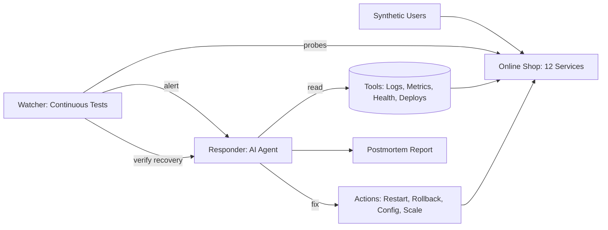

# Sigillum---Night_Watch_Agent
# 🚨 AI On-Call Agent

> An autonomous on-call engineer for a microservice online shop. It continuously tests the system, investigates alerts like a real SRE, fixes the problem safely, and hands developers a clear postmortem.

---

## Table of Contents

- [Overview](#overview)
- [Features](#features)
- [Architecture](#architecture)
- [How It Works](#how-it-works)
- [The Demo Shop](#the-demo-shop)
- [Fault Scenarios](#fault-scenarios)
- [Safety Guardrails](#safety-guardrails)
- [Getting Started](#getting-started)
- [Usage](#usage)
- [Example Postmortem](#example-postmortem)
- [Project Structure](#project-structure)
- [Tech Stack](#tech-stack)
- [Roadmap](#roadmap)
- [Team](#team)
- [License](#license)

---

## Overview

Modern systems break at 3 a.m. This project builds an **agentic AI on-call engineer** for a fake online shop made of **12 services**.

When something breaks, the agent is paged with an alert and must:

1. **Investigate** by reading logs, metrics, health checks, and recent changes
2. **Find the real root cause**, including cases where there are **two separate causes**
3. **Apply a fix** without making things worse
4. **Verify** that the system has actually recovered
5. **Write a short postmortem** explaining what happened and why

The system has two cooperating parts:

| Component | Role |
|-----------|------|
| **Watcher** | Continuously tests the shop (synthetic checks, health and metrics monitoring) and raises alerts when something deviates |
| **Responder** | The AI agent that receives an alert, investigates, remediates, verifies, and reports |

---

## Features

- 🔍 **Continuous testing:** synthetic user flows (browse, cart, checkout) plus service health and metric checks
- 🧠 **Agentic investigation:** the agent chooses its own tools and follows evidence across services
- 🔗 **Dependency-aware debugging:** traces symptoms back through the service graph to the first failing component
- 🧩 **Multi-cause detection:** checks that a single explanation covers every symptom and the timing before stopping
- 🛠️ **Safe remediation:** prefers the least destructive fix, explains its plan first, and verifies afterwards
- 📝 **Automatic postmortems:** timeline, root cause(s), fix, and prevention, backed by real log lines and metric values
- 💥 **Fault injection:** reproducible failure scenarios for testing and demos

---

## Architecture



The Watcher and Responder share one clean handoff: an **alert object goes in, a postmortem comes out**.

---

## How It Works

1. **Detect:** the Watcher notices failing checks, high error rates, or latency spikes and raises an alert.
2. **Triage:** the agent checks the health of all services first, because the alerting service is often a victim, not the cause.
3. **Investigate:** it pulls logs and metrics, follows the dependency graph, and checks what changed recently (deploys, configs, flags).
4. **Hypothesize and test:** it states a root-cause hypothesis and looks for evidence that would confirm or disprove it.
5. **Check for a second cause:** it asks whether any symptoms or timing remain unexplained.
6. **Remediate:** it states the planned action and its risk, applies one change at a time, and prefers rollbacks and reverts over broad restarts.
7. **Verify:** it re-runs the Watcher's checks to confirm recovery and that nothing else degraded.
8. **Report:** it generates a postmortem from its own investigation log.

---

## The Demo Shop

A small online shop built from 12 services. *(Edit this table to match your actual services.)*

| # | Service | Responsibility |
|---|---------|----------------|
| 1 | `frontend` | Web UI |
| 2 | `gateway` | API gateway / routing |
| 3 | `auth` | Login and sessions |
| 4 | `catalog` | Product listing |
| 5 | `search` | Product search |
| 6 | `cart` | Shopping cart |
| 7 | `checkout` | Checkout orchestration |
| 8 | `payments` | Payment processing |
| 9 | `orders` | Order storage |
| 10 | `inventory` | Stock levels |
| 11 | `notifications` | Emails and alerts |
| 12 | `database` / `cache` | Shared data stores |

Every service exposes `/health` and `/metrics` and writes structured logs.

---

## Fault Scenarios

Faults can be injected individually or **combined** to test multi-cause incidents.

| Scenario | Symptom | Typical Fix |
|----------|---------|-------------|
| Bad deploy | Error spike on one route | Roll back the deploy |
| Bad config value | Service misbehaves after a config change | Revert the config |
| Slow dependency | Upstream timeouts and latency | Fix or restart the slow service |
| Memory leak / crash loop | Repeated restarts, growing memory | Restart, then address the leak |
| DB connection exhaustion | Cascading failures across services | Adjust pool size, restart clients |
| **Two faults at once** | Overlapping symptoms | Fix each cause separately |

---

## Safety Guardrails

"Fix it without making things worse" is a core requirement. The agent is constrained by code, not just by prompt:

- Chooses the **least destructive action** that can solve the problem
- Must state **what it will do, why, expected effect, and risk** before acting
- Changes **one thing at a time** and verifies after each change
- **Reverts** a change that doesn't help before trying something else
- Blocks high-risk actions (for example, restarting everything or deleting data)
- Enforces a step limit so investigations cannot loop forever

---

## Getting Started

### Prerequisites

- Docker and Docker Compose
- Python 3.10+ *(update to match your stack)*
- An API key for your LLM provider

### Installation

```bash
git clone https://github.com/<your-username>/<your-repo>.git
cd <your-repo>

cp .env.example .env
# add your LLM API key to .env

docker compose up --build
```

---

## Usage

**Start the shop and the Watcher:**

```bash
docker compose up
```

**Inject a fault:**

```bash
python scripts/inject_fault.py --service payments --type bad_deploy
```

**Inject two faults at once:**

```bash
python scripts/inject_fault.py --service payments --type bad_deploy \
                               --service cache --type memory_leak
```

**Watch the agent work:** the Watcher raises an alert, and the Responder streams its reasoning, tool calls, and actions to the terminal. The postmortem is saved to `reports/`.

---

## Example Postmortem

```markdown
# Incident Postmortem: Checkout failures

**Impact:** ~40% of checkout requests failed for 6 minutes.

## Timeline
- 14:02 Watcher alert: checkout error rate above threshold
- 14:03 Agent finds payments returning 500s
- 14:05 Agent traces the errors to a config change at 14:01
- 14:06 Agent rolls back the config; error rate returns to normal

## Root Cause
A bad config change on `payments` set an invalid gateway timeout.
Evidence: `payments` logs show repeated timeout errors starting at 14:01.

## Fix
Reverted the `payments` config to the previous version and verified checkout success rate recovered.

## Prevention
Validate config values before rollout and alert on payment error rate.
```

---

## Project Structure

*(Adjust to match your repo.)*

```
.
├── agent/
│   ├── responder.py        # AI agent loop
│   ├── tools/              # logs, metrics, health, actions
│   ├── guardrails.py       # safety checks on actions
│   └── postmortem.py       # report generator
├── watcher/
│   └── monitor.py          # continuous tests and alerting
├── shop/
│   └── services/           # the 12 services
├── scripts/
│   └── inject_fault.py     # fault injection
├── reports/                # generated postmortems
├── docker-compose.yml
├── .env.example
└── README.md
```

---

## Tech Stack

- **Services:** `<language/framework>`
- **Orchestration:** Docker Compose
- **Agent:** `<LLM provider / model>` with tool calling
- **Monitoring:** `<metrics and logging approach>`

---

## Roadmap

- [ ] Core shop with 12 services and fault injection
- [ ] Responder agent with log, metric, and health tools
- [ ] Safe remediation actions with guardrails
- [ ] Postmortem generator
- [ ] Watcher with automatic alerting
- [ ] Multi-cause detection
- [ ] Evaluation harness across all fault scenarios
- [ ] Demo polish

---


## License

`<MIT / Apache-2.0 / etc.>`

